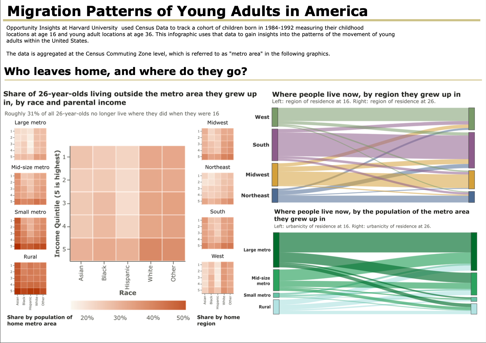
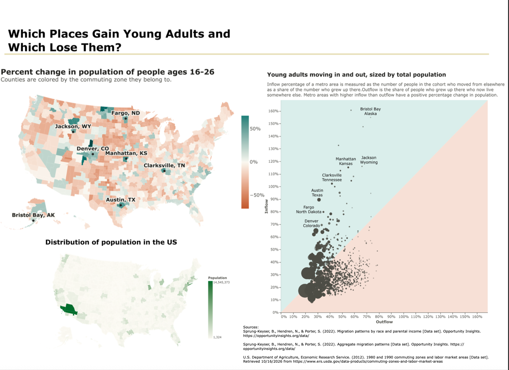

**Migration Patterns of Young Adults in America**
By Hannah Barton

This project uses data from Opportunity Insights at Harvard University. Opportunity Insights used Census Data to track a cohort of children born in 1984-1992 measuring their childhood
locations at age 16 and young adult locations at age 36. This infographic uses that data to gain insights into the patterns of the movement of young adults within the United States.

The Migration Patterns by Race and Parental Income csv file is too large to be stored on Github. It can be downloaded [here](https://opportunityinsights.org/data/?geographic_level=0&topic=0&paper_id=0#resource-listing). The file is in the section "The Radius of Economic Opportunity: Evidence from Migration and Local Labor Markets".  

Sources: 
Sprung-Keyser, B., Hendren, N., & Porter, S. (2022). *Migration patterns by race and parental income* [Data set]. Opportunity Insights. https://opportunityinsights.org/data/

Sprung-Keyser, B., Hendren, N., & Porter, S. (2022). *Aggregate migration patterns* [Data set]. Opportunity Insights. https://opportunityinsights.org/data/

U.S. Department of Agriculture, Economic Research Service. (2012). *1980 and 1990 commuting zones and labor market areas* [Data set]. Retrieved 10/16/2026 from https://www.ers.usda.gov/data-products/commuting-zones-and-labor-market-areas