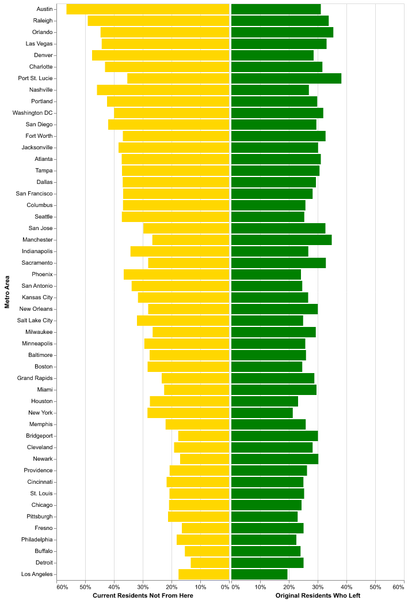
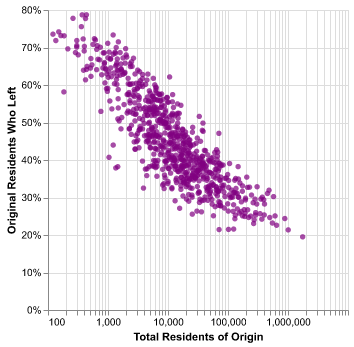
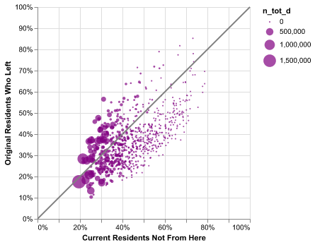
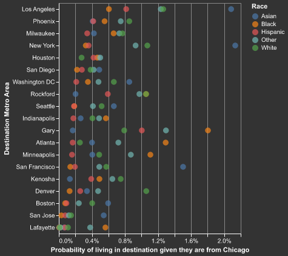
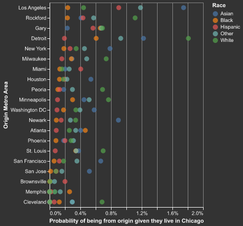
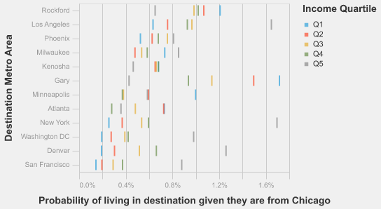
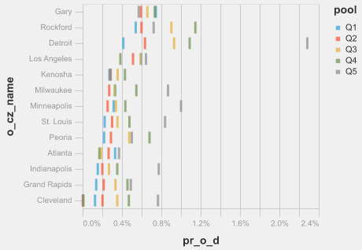
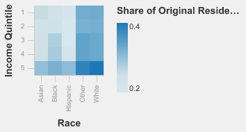
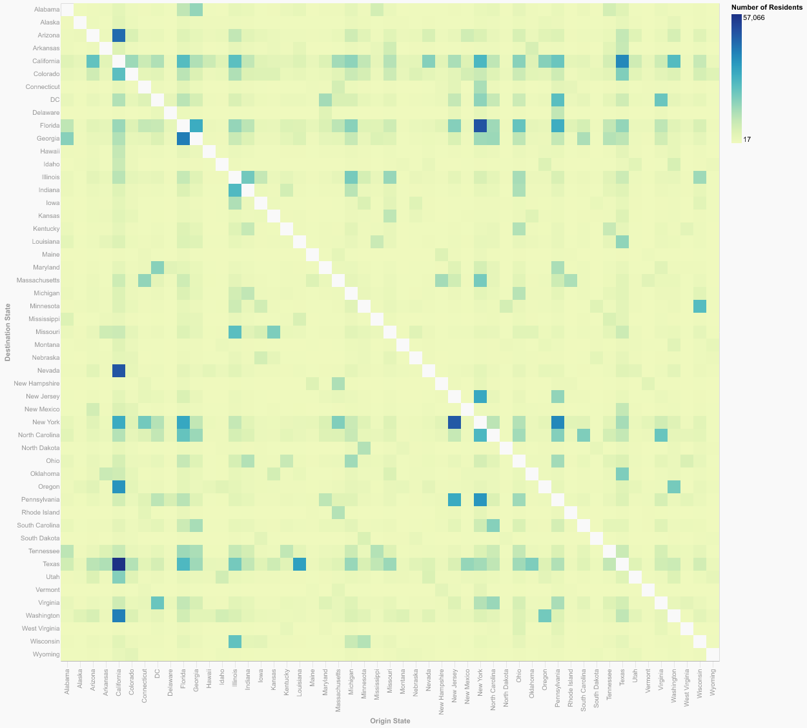
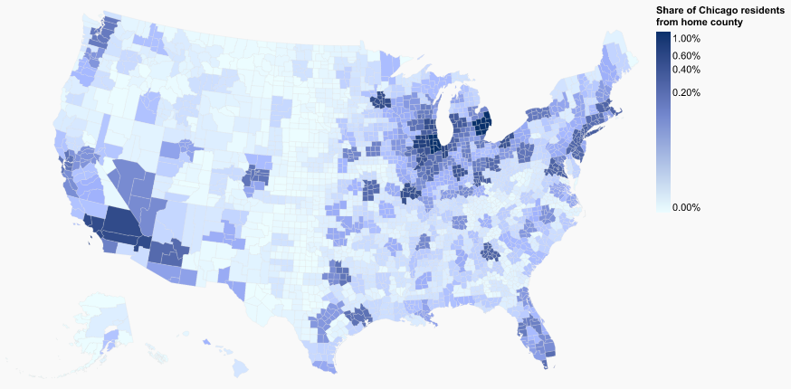

# {Project Name}

Hannah Barton

## What is your current goal? Has it changed since the proposal?
My current goal has changed to just show migration data of young Americans withing the United States, with a focus on Chicago 
differences based on race and income. 

## Are there data challenges you are facing? Are you currently depending on mock data?
The format of the data is a little confusing because you have to keep track of both destination and origin. Then there are probabilities for each group of the likelihood they are from an origin given they live in a destination, and vice verse, which is a little difficult
to wrap your head around. There is also a lot of data, which is hard to show all together.

## Describe each of the provided images with 2-3 sentences to give the context and how it relates to your goal.

#Graph 1

This is a bar chart that takes the top 50 communting zones and looks at the percent of current residents who 
are not from there, with another bar chart next to it showing the percent of residents who were from there but now live somewhere else. The percentages are based on ome cohort of young adults.

#Graph 2

This scatterplot shows the size of a metro area on the X axis and the percent of 
residents from there who no longer live there. You can see a trend that larger areas have a lower percentage of outgoing 
population. The X axis is on a log scale.

#Graph 3

This plot shows the gap between residents who left and new residents, as well as the size of the area. 
Points closer to the x = y line have uneven incoming vs. outgoing. 

#Graph 4

This graph shows the probability that a young person lives in a given area if they are from Chicago. The colors are broken out by race.

#Graph 5

This graph shows the probability that a young person is from a given area if they currently live in Chicago. The colors are broken out by race.

#Graph 6

This graph shows the probability that a young person lives in a given area if they are from Chicago. The colors are broken out by income quintile.

#Graph 7

This graph shows the probability that a young person is from a given area if they currently live in Chicago. The colors are broken out by income quintile.

#Graph 8

This is a heatmap showing the share of young people who no longer live in the place they are from, broken up by race and income. The darker areas have a higher percentage.

#Graph 9

This is a heatmap that groups the commuting zones by state and highlights the number of residents from an origin state living in a destination state. The diagonal is whited out to preserve color variation.

#Graph 10

This is a chloropleth/heatmap showing the home counties of Chicago residents. The darker the color, the higher share of current Chicago residents are from this county.

## What form do you envision your final narrative taking? (e.g. An article incorporating the images? A poster? An infographic?)
I think it will be some sort of inforgraphic with descriptions. 